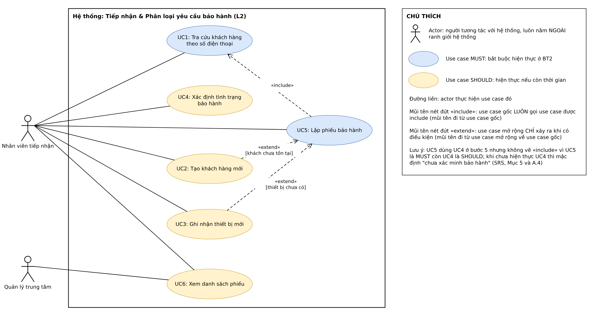

# BẢN ĐẶC TẢ YÊU CẦU PHẦN MỀM (SRS RÚT GỌN)

**Hệ thống:** Smart CRM Mekong Mobile
**Luồng nghiệp vụ:** L2 – Tiếp nhận và phân loại yêu cầu bảo hành
**Sinh viên:** Võ Phạm Việt Phú · **MSSV:** 2374802010391 · **Track:** Công nghệ Phần mềm (SE)
**Học phần:** Chuyên đề tốt nghiệp 1

---

## 1. Giới thiệu và phạm vi

### 1.1. Bối cảnh

Mekong Mobile là chuỗi 24 cửa hàng và 6 trung tâm bảo hành, trung bình 260 phiếu bảo hành mỗi tháng. Phiếu hiện được ghi trên giấy, mỗi trung tâm lưu một cách, nên không ai biết phiếu đang ở bước nào (khoảng 15% phiếu quá hạn mà không được cảnh báo, vấn đề V2). Mô tả lỗi ghi tự do, không phân nhóm, nên không thống kê được nguyên nhân bảo hành (V8). Cuối ngày nhân viên tiếp nhận phải chép lại phiếu sang Excel, mất khoảng 40 phút.

### 1.2. Phạm vi

Nhân viên tiếp nhận tra cứu khách theo số điện thoại, ghi nhận thiết bị, xác định tình trạng bảo hành, chọn nhóm sự cố và mức ưu tiên để lập phiếu bảo hành có mã và hạn cam kết, kết thúc khi phiếu được lưu ở trạng thái MỚI; quản lý trung tâm xem danh sách phiếu của trung tâm mình theo hạn cam kết.

### 1.3. Điều chủ ý KHÔNG làm (WON'T)

| Mã  | Nội dung không làm                                                                          | Lý do                                                                                                                              |
| --- | ------------------------------------------------------------------------------------------- | ---------------------------------------------------------------------------------------------------------------------------------- |
| W1  | Phân công kỹ thuật viên, đặt lịch hẹn                                                       | Thuộc luồng L4                                                                                                                     |
| W2  | Đổi trạng thái phiếu sau MỚI và đóng phiếu                                                  | Thuộc các luồng L4, L5                                                                                                             |
| W3  | Quản lý tồn kho, xuất linh kiện                                                             | Thuộc luồng L5                                                                                                                     |
| W4  | Khảo sát hài lòng sau bảo hành                                                              | Thuộc luồng L8                                                                                                                     |
| W5  | Tự động phân loại nhóm sự cố (luật hoặc học máy)                                            | Thuộc luồng L10; bản này nhân viên tự chọn nhóm từ danh mục                                                                        |
| W6  | Báo cáo tổng hợp, dashboard toàn công ty                                                    | Thuộc luồng L6                                                                                                                     |
| W7  | Gộp hồ sơ khách hàng trùng                                                                  | Thuộc luồng L1, L7                                                                                                                 |
| W8  | Đính kèm ảnh, in phiếu, gửi tin nhắn cho khách; sửa, xóa khách hàng; hủy phiếu              | Mức COULD, ghi vào hướng mở rộng                                                                                                   |
| W9  | Tìm phiếu theo mã phiếu hoặc số điện thoại; lọc danh sách phiếu theo trạng thái             | Mức COULD; lọc theo trạng thái chỉ có nghĩa khi L4, L5 đổi trạng thái phiếu (xem W2)                                               |
| W10 | Cảnh báo thiết bị đã sửa từ 3 lần trở lên cùng một lỗi (gợi ý của anh Dũng, kỹ thuật viên)  | Cần lịch sử sửa chữa theo thiết bị; thuộc luồng L4 và hướng mở rộng                                                                |
| W11 | Màn hình quản trị danh mục nhóm sự cố; xử lý ngày lễ khi tính hạn cam kết                   | Mức COULD; bản này cập nhật danh mục bằng dữ liệu cấu hình                                                                         |
| W12 | Quản lý trung tâm quyết định "miễn phí" hoặc "có tính phí" cho phiếu chưa xác minh bảo hành | Bản này chỉ đánh dấu phiếu chờ quản lý quyết định; chức năng quyết định để hướng mở rộng                                           |
| W13 | Đăng ký và quản lý tài khoản người dùng                                                     | Hạ tầng dùng chung, không phải nghiệp vụ của L2; bản này chỉ đăng nhập bằng tài khoản mẫu cấp sẵn để xác định vai trò và trung tâm |

### 1.4. Thuật ngữ

| Thuật ngữ           | Định nghĩa                                                                                                                                                                | Tên kỹ thuật                   |
| ------------------- | ------------------------------------------------------------------------------------------------------------------------------------------------------------------------- | ------------------------------ |
| Khách hàng          | Cá nhân đã mua sản phẩm hoặc dùng dịch vụ của Mekong Mobile                                                                                                               | customer                       |
| Thiết bị            | Một máy cụ thể của khách, xác định bằng serial/IMEI                                                                                                                       | device                         |
| Sản phẩm            | Dòng máy trong danh mục (ví dụ Samsung Galaxy A52), có số tháng bảo hành mặc định                                                                                         | product                        |
| Phiếu bảo hành      | Một yêu cầu bảo hành hoặc sửa chữa, có mã duy nhất và vòng đời trạng thái                                                                                                 | ticket                         |
| Mã phiếu            | Mã hiển thị duy nhất của phiếu bảo hành, dạng BH000123/2026                                                                                                               | ticket_code                    |
| Trạng thái phiếu    | Vị trí của phiếu trong vòng đời: Mới → Đã phân công → Đang xử lý → Chờ linh kiện → Hoàn tất → Đã đóng; hoặc Đã hủy. Trong phạm vi L2, phiếu chỉ được lập ở trạng thái Mới | ticket_status                  |
| Lịch sử trạng thái  | Bản ghi mỗi lần phiếu đổi trạng thái: trạng thái trước và sau, thời điểm, người thực hiện                                                                                 | ticket_status_log              |
| Hạn cam kết         | Thời điểm chậm nhất phải hoàn tất phiếu, tính từ lúc tiếp nhận theo mức ưu tiên                                                                                           | due_date                       |
| Phiếu quá hạn       | Phiếu có hạn cam kết sớm hơn thời điểm hiện tại và chưa ở trạng thái Hoàn tất hoặc Đã đóng                                                                                | (tính khi truy vấn, không lưu) |
| Nhóm sự cố          | Phân loại nguyên nhân: màn hình, pin, sạc, phần mềm, nước vào, khác                                                                                                       | issue_category                 |
| Mức ưu tiên         | Cao, Trung bình, Thấp; quyết định hạn cam kết                                                                                                                             | priority                       |
| Tình trạng bảo hành | Còn bảo hành, hết bảo hành, hoặc chưa xác minh bảo hành (thiếu ngày mua)                                                                                                  | warranty_status                |
| Trung tâm bảo hành  | Đơn vị tiếp nhận và xử lý phiếu; nhân viên và quản lý chỉ thuộc một trung tâm                                                                                             | service_center                 |

[//]: # '**Quy ước dùng từ:** toàn bộ tài liệu và sơ đồ chỉ dùng "**lập** phiếu bảo hành" (không dùng "tạo phiếu"), "**xác định** tình trạng bảo hành" (không dùng "kiểm tra"), và "chưa xác minh bảo hành" (không rút gọn thành "chưa xác minh"). "Tạo" chỉ dùng cho khách hàng mới.'

---

## 2. Các bên liên quan và vai trò người dùng

| Vai trò             | Được làm                                                                                                                                                     | Không được làm                                                                                                                                                        |
| :------------------ | :----------------------------------------------------------------------------------------------------------------------------------------------------------- | :-------------------------------------------------------------------------------------------------------------------------------------------------------------------- |
| Nhân viên tiếp nhận | Tra cứu và tạo khách hàng, ghi nhận thiết bị, xác định tình trạng bảo hành, lập phiếu bảo hành, chọn nhóm sự cố và mức ưu tiên, xem phiếu của trung tâm mình | Xem số điện thoại đầy đủ (chỉ thấy dạng che); tự ghi "còn bảo hành" cho phiếu chưa xác minh bảo hành; xem phiếu của trung tâm khác; xóa phiếu hoặc khách hàng (QT-13) |
| Quản lý trung tâm   | Xem toàn bộ phiếu của trung tâm mình (kể cả phiếu chưa xác minh bảo hành đang chờ quyết định), xem số điện thoại đầy đủ                                      | Xem phiếu của trung tâm không phụ trách; xóa vật lý phiếu hoặc khách hàng (QT-13)                                                                                     |

---

## 3. Yêu cầu chức năng

### 3.1. Danh sách yêu cầu chức năng

| Mã   | Yêu cầu chức năng                                                                                                                                                                                                                                                                                                                          |
| ---- | ------------------------------------------------------------------------------------------------------------------------------------------------------------------------------------------------------------------------------------------------------------------------------------------------------------------------------------------ |
| FR1  | Hệ thống cho phép tra cứu khách hàng theo số điện thoại; số nhập vào được chuẩn hóa về 10 chữ số bắt đầu bằng 0 trước khi tra; nếu tìm thấy thì hiển thị hồ sơ khách.                                                                                                                                                                      |
| FR2  | Hệ thống cho phép tạo khách hàng mới khi số điện thoại chưa tồn tại; họ tên và số điện thoại là bắt buộc, số điện thoại không được trùng.                                                                                                                                                                                                  |
| FR3  | Hệ thống hiển thị danh sách thiết bị của khách (tên máy, serial/IMEI, ngày mua) và cho chọn một thiết bị để lập phiếu.                                                                                                                                                                                                                     |
| FR4  | Hệ thống cho phép ghi nhận thiết bị mới cho khách; tên máy (chọn từ danh mục sản phẩm) và serial/IMEI là bắt buộc, serial/IMEI không được trùng; ngày mua được để trống nhưng không được ở tương lai; số tháng bảo hành điền sẵn theo sản phẩm (mặc định 12), nhân viên được sửa trong khoảng 1–60 tháng cho máy có chế độ bảo hành riêng. |
| FR5  | Hệ thống xác định tình trạng bảo hành tại thời điểm tiếp nhận theo QT-05 và hiển thị một trong ba kết quả: còn bảo hành, hết bảo hành, chưa xác minh bảo hành (thiếu ngày mua).                                                                                                                                                            |
| FR6  | Hệ thống cho phép lập phiếu với các trường bắt buộc: khách hàng, thiết bị, mô tả lỗi (trung tâm do hệ thống điền theo trung tâm của nhân viên); khi lưu thì sinh mã phiếu duy nhất, đặt trạng thái MỚI, ghi thời điểm tiếp nhận và dòng lịch sử trạng thái đầu tiên.                                                                       |
| FR7  | Hệ thống cho phép chọn nhóm sự cố từ danh mục có sẵn; nhóm sự cố không bắt buộc, nếu không chọn thì phiếu được lưu với nhóm để trống (chưa phân loại).                                                                                                                                                                                     |
| FR8  | Hệ thống điền sẵn mức ưu tiên theo mặc định của nhóm sự cố đã chọn (Trung bình nếu chưa chọn nhóm) và cho nhân viên đổi sang Cao, Trung bình hoặc Thấp.                                                                                                                                                                                    |
| FR9  | Hệ thống tự sinh hạn cam kết từ thời điểm tiếp nhận: Cao 24 giờ, Trung bình 72 giờ, Thấp 120 giờ; mỗi Chủ nhật nằm trong khoảng tính được cộng thêm 24 giờ; phiếu tiếp nhận vào Chủ nhật được tính từ 00:00 thứ Hai.                                                                                                                       |
| FR10 | Hệ thống hiển thị danh sách phiếu của trung tâm mình, sắp theo hạn cam kết tăng dần, phân trang 20 dòng.                                                                                                                                                                                                                                   |
| FR11 | Hệ thống đánh dấu phiếu quá hạn: phiếu có hạn cam kết sớm hơn thời điểm hiện tại và chưa ở trạng thái Hoàn tất hoặc Đã đóng.                                                                                                                                                                                                               |

### 3.2. User Story và mức MoSCoW

| Mã  | User Story                                                                                                                                                                                      | MoSCoW     |
| --- | ----------------------------------------------------------------------------------------------------------------------------------------------------------------------------------------------- | ---------- |
| US1 | **Là nhân viên tiếp nhận**, tôi muốn tra cứu khách bằng số điện thoại và xem danh sách thiết bị của khách để không phải hỏi lại tên, địa chỉ và máy khách đã mua.                               | **MUST**   |
| US2 | **Là nhân viên tiếp nhận**, tôi muốn tạo hồ sơ cho khách chưa có trong hệ thống ngay lúc tiếp nhận để không phải ghi tay rồi nhập bổ sung.                                                      | **SHOULD** |
| US3 | **Là nhân viên tiếp nhận**, tôi muốn ghi nhận thiết bị chưa có trong hệ thống để vẫn tiếp nhận được máy mà không phải làm giấy riêng.                                                           | **SHOULD** |
| US4 | **Là nhân viên tiếp nhận**, tôi muốn biết thiết bị còn hay hết bảo hành, hoặc chưa xác minh bảo hành, để không phải lật sổ hay gọi cửa hàng tra ngày mua.                                       | **MUST**   |
| US5 | **Là nhân viên tiếp nhận**, tôi muốn lập phiếu bảo hành trên hệ thống với hạn cam kết tự tính theo mức ưu tiên để hẹn ngày trả máy có căn cứ thay vì ước lượng theo kinh nghiệm.                | **MUST**   |
| US6 | **Là nhân viên tiếp nhận**, tôi muốn phân loại phiếu theo một danh mục nhóm sự cố chung của công ty để thống kê được nguyên nhân bảo hành phổ biến nhất.                                        | **SHOULD** |
| US7 | **Là quản lý trung tâm**, tôi muốn xem danh sách phiếu của trung tâm sắp theo hạn cam kết, có đánh dấu phiếu quá hạn, để xử lý phiếu sắp trễ trước và không phải ngồi đếm tay số phiếu quá hạn. | **SHOULD** |

### 3.3. Tiêu chí chấp nhận cho các story MUST

#### US1

- **AC1.** GIVEN số 0901234567 đã có trong hệ thống, WHEN nhân viên nhập số này (hoặc +84901234567), THEN hệ thống hiển thị đúng hồ sơ khách và danh sách thiết bị.
- **AC2 (ngoại lệ).** GIVEN số điện thoại chưa có trong hệ thống, WHEN nhân viên tra cứu, THEN hệ thống báo không tìm thấy và đề nghị tạo khách mới.
- **AC3 (ngoại lệ).** GIVEN số nhập vào không đủ 10 chữ số sau khi chuẩn hóa, WHEN nhân viên tra cứu, THEN hệ thống từ chối và nêu rõ lý do.

#### US4

- **AC1.** GIVEN thiết bị mua ngày 05/03/2026, bảo hành 12 tháng, WHEN tiếp nhận ngày 05/03/2027, THEN hệ thống hiển thị "Còn bảo hành" (ngày cuối cùng còn bảo hành).
- **AC2 (ngoại lệ, giá trị biên).** GIVEN cùng thiết bị trên, WHEN tiếp nhận ngày 06/03/2027, THEN hệ thống hiển thị "Hết bảo hành"; phiếu vẫn lập được và được ghi là có tính phí.
- **AC3 (ngoại lệ).** GIVEN thiết bị không có ngày mua, WHEN tiếp nhận, THEN hệ thống hiển thị "Chưa xác minh bảo hành", vẫn cho lập phiếu và đánh dấu phiếu chờ Quản lý trung tâm quyết định.

#### US5

- **AC1.** GIVEN khách, thiết bị và mô tả lỗi hợp lệ, WHEN nhân viên bấm Lưu phiếu, THEN phiếu được lưu với mã duy nhất, trạng thái MỚI, có thời điểm tiếp nhận và một dòng lịch sử trạng thái đầu tiên.
- **AC2 (ngoại lệ).** GIVEN mô tả lỗi để trống hoặc dưới 10 ký tự, WHEN bấm Lưu phiếu, THEN hệ thống từ chối, nêu rõ trường chưa hợp lệ và giữ nguyên dữ liệu đã nhập.
- **AC3 (ngoại lệ).** GIVEN thiết bị được chọn không thuộc khách đang tiếp nhận, WHEN bấm Lưu phiếu, THEN hệ thống từ chối và thông báo thiết bị không thuộc khách hàng này.
- **AC4.** GIVEN phiếu mức CAO tiếp nhận lúc 09:00 thứ Hai, WHEN lưu phiếu, THEN hạn cam kết là 09:00 thứ Ba.
- **AC5.** GIVEN phiếu mức TRUNG_BINH tiếp nhận lúc 14:30 thứ Năm, WHEN lưu phiếu, THEN hạn cam kết là 14:30 thứ Hai tuần sau (bỏ qua Chủ nhật).
- **AC6 (ngoại lệ).** GIVEN phiếu mức CAO tiếp nhận lúc 10:00 thứ Bảy, WHEN lưu phiếu, THEN hạn cam kết là 10:00 thứ Hai, không rơi vào Chủ nhật.

---

## 4. Yêu cầu phi chức năng

| Mã   | Loại      | Yêu cầu (có ngưỡng đo được)                                                                                                                                                                      | Cách kiểm chứng                                                                    |
| :--- | :-------- | :----------------------------------------------------------------------------------------------------------------------------------------------------------------------------------------------- | :--------------------------------------------------------------------------------- |
| NFR1 | Hiệu năng | Trang đầu (20 dòng) của danh sách phiếu hiển thị dưới 2 giây với 10.000 phiếu; tra cứu khách theo số điện thoại dưới 1 giây với 65.000 hồ sơ                                                     | Nạp dữ liệu mẫu, đo thời gian phản hồi                                             |
| NFR2 | Bảo mật   | Nhân viên tiếp nhận chỉ thấy số điện thoại khách ở dạng che 4 số (ví dụ 090\*\*\*\*567); chỉ Quản lý trung tâm thấy đầy đủ. Đúng ở 100% màn hình và 100% kết quả trả về.                         | Đăng nhập lần lượt hai vai trò, kiểm tra từng màn hình và từng phản hồi API        |
| NFR3 | Khả dụng  | Một nhân viên tiếp nhận mới, chưa được hướng dẫn, lập xong một phiếu bảo hành đúng trong dưới 3 phút.                                                                                            | Cho 3 người thử, bấm giờ từng người                                                |
| NFR4 | Tin cậy   | Bản ghi phiếu và dòng lịch sử trạng thái đầu tiên được lưu trong một giao dịch; khi mất kết nối hoặc lỗi giữa chừng, có 0 phiếu lưu thiếu lịch sử và 0 phiếu trùng mã khi nhân viên thử lưu lại. | Giả lập ngắt kết nối ở 20 lần lưu liên tiếp, đếm phiếu thiếu lịch sử hoặc trùng mã |
| NFR5 | Bảo trì   | Thêm một nhóm sự cố mới hoặc đổi mức ưu tiên mặc định của một nhóm chỉ cần thêm hoặc sửa 1 dòng dữ liệu danh mục; 0 dòng mã nguồn phải sửa và không cần triển khai lại.                          | Thêm thử một nhóm mới vào danh mục, kiểm tra nhóm xuất hiện trên form lập phiếu    |

---

## 5. Ràng buộc và quy tắc nghiệp vụ

| Mã    | Quy tắc                                                                                                                                                                              | Liên quan        |
| ----- | ------------------------------------------------------------------------------------------------------------------------------------------------------------------------------------ | ---------------- |
| QT-01 | Số điện thoại khách là duy nhất; nhập số đã tồn tại thì hiển thị hồ sơ có sẵn, không tạo mới.                                                                                        | FR1, FR2         |
| QT-02 | Số điện thoại được chuẩn hóa về 10 chữ số bắt đầu bằng 0 (chấp nhận +84…, 84…, dấu cách, dấu chấm).                                                                                  | FR1, FR2         |
| QT-03 | Thiết bị xác định duy nhất bằng serial/IMEI; một thiết bị chỉ thuộc một khách tại một thời điểm.                                                                                     | FR4, FR6         |
| QT-04 | Hạn cam kết: Cao 24 giờ, Trung bình 72 giờ, Thấp 120 giờ; chỉ tính thứ Hai đến thứ Bảy.                                                                                              | FR9              |
| QT-05 | Còn bảo hành nếu (ngày tiếp nhận − ngày mua) ≤ số tháng bảo hành; thiếu ngày mua thì "chưa xác minh bảo hành", cần quản lý quyết định (chức năng quyết định nằm ngoài phạm vi, W12). | FR5              |
| QT-06 | Mọi lần chuyển trạng thái đều phải ghi vào lịch sử; trong phạm vi L2, phiếu mới lập ở trạng thái MỚI và ghi dòng lịch sử đầu tiên.                                                   | FR6              |
| QT-13 | Không xóa vật lý phiếu, đơn hàng, hồ sơ khách; chỉ đánh dấu ngừng sử dụng.                                                                                                           | Tất cả           |
| QT-14 | Nhân viên chỉ xem dữ liệu của trung tâm mình; quản lý xem toàn bộ đơn vị phụ trách.                                                                                                  | FR10, FR11, NFR2 |
| QT-15 | Số điện thoại hiển thị dạng che với mọi vai trò trừ Quản lý và Ban giám đốc.                                                                                                         | FR1, FR10, NFR2  |

---

## 6. Bảng truy vết yêu cầu

| Mã FR | Yêu cầu chức năng (rút gọn)                                       | User Story | Use Case | MoSCoW | Bảng dữ liệu                                                      | Màn hình |
| ----- | ----------------------------------------------------------------- | ---------- | -------- | ------ | ----------------------------------------------------------------- | -------- |
| FR1   | Tra cứu khách theo số điện thoại (có chuẩn hóa số)                | US1        | UC1      | MUST   | customer                                                          | M1       |
| FR2   | Tạo khách mới khi số điện thoại chưa tồn tại                      | US2        | UC2      | SHOULD | customer                                                          | M2       |
| FR3   | Hiển thị danh sách thiết bị của khách và chọn thiết bị            | US1        | UC1      | MUST   | device, product                                                   | M1       |
| FR4   | Ghi nhận thiết bị mới chưa có trong danh sách                     | US3        | UC3      | SHOULD | device, product                                                   | M2       |
| FR5   | Xác định tình trạng bảo hành (còn / hết / chưa xác minh bảo hành) | US4        | UC4      | MUST   | device, ticket                                                    | M1       |
| FR6   | Lập phiếu: sinh mã, trạng thái MỚI, ghi lịch sử đầu tiên          | US5        | UC5      | MUST   | ticket, ticket_status_log, service_center, employee               | M1       |
| FR7   | Chọn nhóm sự cố từ danh mục (không bắt buộc)                      | US6        | UC5      | SHOULD | issue_category, ticket                                            | M1       |
| FR8   | Điền sẵn mức ưu tiên theo nhóm, cho phép đổi                      | US6        | UC5      | SHOULD | issue_category, ticket                                            | M1       |
| FR9   | Tự sinh hạn cam kết theo mức ưu tiên                              | US5        | UC5      | MUST   | ticket                                                            | M1       |
| FR10  | Danh sách phiếu của trung tâm, sắp theo hạn cam kết               | US7        | UC6      | SHOULD | ticket, customer, device, product, issue_category, service_center | M3       |
| FR11  | Đánh dấu phiếu quá hạn                                            | US7        | UC6      | SHOULD | ticket                                                            | M3       |

Ghi chú: service_center và employee là bảng dùng chung, chỉ dựng tối thiểu để tham chiếu: trung tâm tiếp nhận của phiếu, người ghi lịch sử trạng thái và tài khoản đăng nhập mẫu (W13). Các mục WON'T (W1–W13) không có dòng trong bảng này.

---

# PHỤ LỤC

## Phụ lục A. Use Case Diagram

[//]: # '_File gốc có thể chỉnh sửa: `docs/usecase.drawio`._'

### A.1. Chú thích ký hiệu

| Ký hiệu                          | Ý nghĩa                                                                                                           |
| -------------------------------- | ----------------------------------------------------------------------------------------------------------------- |
| Hình người                       | Actor: người tương tác với hệ thống, luôn nằm ngoài ranh giới hệ thống                                            |
| Hình elip                        | Use case: một chức năng mà actor thực hiện, đặt tên dạng động từ + đối tượng                                      |
| Màu elip                         | Xanh dương = MUST; vàng = SHOULD                                                                                  |
| Khung chữ nhật bao quanh         | Ranh giới hệ thống: mọi use case bên trong thuộc phạm vi L2                                                       |
| Đường liền nối actor và use case | Actor thực hiện use case đó                                                                                       |
| Mũi tên nét đứt `<<include>>`    | Use case gốc luôn gọi use case được include (bước bắt buộc); mũi tên đi từ use case gốc tới use case được include |
| Mũi tên nét đứt `<<extend>>`     | Use case mở rộng chỉ xảy ra khi có điều kiện; mũi tên đi từ use case mở rộng về use case gốc                      |

### A.2. Các actor

| Actor               | Vai trò trong sơ đồ                                                   | Use case thực hiện           |
| ------------------- | --------------------------------------------------------------------- | ---------------------------- |
| Nhân viên tiếp nhận | Tiếp nhận yêu cầu tại trung tâm bảo hành, là người dùng chính         | UC1, UC2, UC3, UC4, UC5, UC6 |
| Quản lý trung tâm   | Giám sát phiếu của trung tâm mình, kể cả phiếu chưa xác minh bảo hành | UC6                          |

### A.3. Các use case

| Mã  | Tên use case                          | Mô tả ngắn                                                                                                                                           | User Story | Ưu tiên |
| --- | ------------------------------------- | ---------------------------------------------------------------------------------------------------------------------------------------------------- | ---------- | ------- |
| UC1 | Tra cứu khách hàng theo số điện thoại | Tìm khách theo số điện thoại đã chuẩn hóa, hiển thị hồ sơ và thiết bị                                                                                | US1        | MUST    |
| UC2 | Tạo khách hàng mới                    | Tạo hồ sơ khi số điện thoại chưa tồn tại                                                                                                             | US2        | SHOULD  |
| UC3 | Ghi nhận thiết bị mới                 | Thêm thiết bị (bắt buộc tên máy và serial/IMEI) khi chưa có trong danh sách của khách                                                                | US3        | SHOULD  |
| UC4 | Xác định tình trạng bảo hành          | Xác định còn bảo hành, hết bảo hành hoặc chưa xác minh bảo hành theo QT-05                                                                           | US4        | MUST    |
| UC5 | Lập phiếu bảo hành                    | Ghi nhận phiếu mới, chọn nhóm sự cố và mức ưu tiên, sinh mã phiếu và hạn cam kết                                                                     | US5, US6   | MUST    |
| UC6 | Xem danh sách phiếu                   | Quản lý trung tâm xem phiếu của trung tâm mình sắp theo hạn cam kết, đánh dấu quá hạn; nhân viên tiếp nhận xem được phiếu của trung tâm mình (QT-14) | US7        | SHOULD  |

### A.4. Quan hệ giữa các use case

- UC5 `<<include>>` UC1: lập phiếu luôn bắt đầu bằng việc tra cứu khách (bước 3).
- UC5 `<<include>>` UC4: bước 5 của lập phiếu luôn xác định tình trạng bảo hành, nên đây là bước bắt buộc chứ không phụ thuộc điều kiện.
- UC2 `<<extend>>` UC5: chỉ xảy ra khi khách chưa tồn tại (điểm mở rộng ở bước 3, ngoại lệ 3a).
- UC3 `<<extend>>` UC5: chỉ xảy ra khi thiết bị chưa có trong danh sách của khách (điểm mở rộng ở bước 4, ngoại lệ 4a).

---

## Phụ lục B. Đặc tả use case UC5 – Lập phiếu bảo hành

### B.1. Thông tin chung

- **Actor chính:** Nhân viên tiếp nhận
- **Mục tiêu:** Ghi nhận một yêu cầu bảo hành vào hệ thống để theo dõi đến khi đóng.
- **Điều kiện trước:** Nhân viên đã đăng nhập, có vai trò tiếp nhận và thuộc một trung tâm bảo hành.
- **Điều kiện sau:** Một phiếu ở trạng thái MỚI được lưu, có mã phiếu duy nhất, tình trạng bảo hành, hạn cam kết và một dòng lịch sử trạng thái đầu tiên.
- **Liên quan:** US4, US5, US6 · include UC1, UC4 · extend UC2, UC3 | **Mức ưu tiên:** MUST

### B.2. Luồng chính

1. Nhân viên chọn chức năng "Lập phiếu bảo hành mới".
2. Nhân viên nhập số điện thoại khách.
3. Hệ thống chuẩn hóa số, tra cứu và hiển thị thông tin khách cùng danh sách thiết bị. _[include UC1]_
4. Nhân viên chọn thiết bị cần bảo hành.
5. Hệ thống xác định tình trạng bảo hành theo QT-05 và hiển thị kết quả: còn bảo hành, hết bảo hành, hoặc chưa xác minh bảo hành. _[include UC4]_
6. Nhân viên nhập mô tả lỗi.
7. Nhân viên chọn nhóm sự cố (không bắt buộc); hệ thống điền sẵn mức ưu tiên mặc định của nhóm; nhân viên xác nhận hoặc đổi mức ưu tiên.
8. Nhân viên bấm Lưu phiếu.
9. Hệ thống kiểm tra dữ liệu, sinh mã phiếu, sinh hạn cam kết theo mức ưu tiên (QT-04), lưu phiếu ở trạng thái MỚI cùng dòng lịch sử trạng thái đầu tiên trong một giao dịch (NFR4), rồi hiển thị mã phiếu và hạn cam kết.

### B.3. Luồng ngoại lệ

- **3a. Khách chưa tồn tại.** Hệ thống báo không tìm thấy và mở form tạo khách mới với số điện thoại đã điền sẵn _[extend UC2]_; sau khi lưu khách, quay lại bước 4.
- **3b. Số điện thoại không hợp lệ** (không đủ 10 chữ số sau khi chuẩn hóa). Hệ thống từ chối, nêu rõ lý do, cho nhập lại.
- **4a. Thiết bị chưa có trong danh sách của khách.** Cho ghi nhận thiết bị mới, bắt buộc có tên máy và serial/IMEI _[extend UC3]_; sau khi lưu, quay lại bước 5. Nếu serial đã thuộc khách khác, hệ thống từ chối (QT-03).
- **5a. Thiếu ngày mua.** Hệ thống hiển thị "chưa xác minh bảo hành", vẫn cho lập phiếu và đánh dấu phiếu chờ Quản lý trung tâm quyết định (chức năng quyết định ngoài phạm vi, W12). Đây là cách xử lý có kiểm soát cho "đường tránh" ở bước 4 của Mục 6.1 trong tài liệu case study.
- **5b. Hết bảo hành.** Hệ thống hiển thị cảnh báo; nhân viên vẫn lập phiếu được, phiếu được ghi là có tính phí.
- **7a. Nhân viên không chọn nhóm sự cố.** Hệ thống vẫn cho lưu, nhóm sự cố để trống (chưa phân loại) và mức ưu tiên mặc định là Trung bình.
- **9a. Mô tả lỗi để trống hoặc dưới 10 ký tự.** Hệ thống từ chối lưu, nêu rõ trường chưa hợp lệ, giữ nguyên dữ liệu đã nhập.
- **9b. Thiết bị được chọn không thuộc khách đang tiếp nhận** (QT-03). Hệ thống từ chối lưu và thông báo thiết bị không thuộc khách hàng này.
- **9c. Mất kết nối khi đang lưu.** Hệ thống giữ dữ liệu trên giao diện, cho thử lưu lại; lần lưu lại dùng cùng khóa chống trùng nên không lập phiếu trùng (NFR4).

---

## Phụ lục C. Peer review

- **Peer review với:** Thái An Quốc – 2374802012635 (track SE)
- **Tóm tắt phạm vi bạn đọc đã trình bày lại sau 5 phút (ghi đúng lời bạn nói):** Web làm phần tiếp nhận bảo hành ở quầy. Nhân viên gõ số điện thoại để tìm hoặc tạo khách, chọn máy theo IMEI, xem còn hạn bảo hành không rồi chọn lỗi để tạo phiếu. Hệ thống tự tính ngày hẹn trả máy, xong lưu phiếu ở trạng thái MỚI là hết việc của luồng này. Quản lý thì xem được danh sách để biết phiếu nào trễ hạn. Việc giao cho thợ, sửa máy hay trừ kho linh kiện thì không làm
- **Đối chiếu với phạm vi gốc:** [x] Đúng ☐ Đúng một phần ☐ Sai _(chỉ tick sau khi đã ghi lời tóm tắt ở trên)_
- **Điểm bạn thấy chưa rõ hoặc mâu thuẫn:**
    1. Thiếu API Contract
- **Tôi đã chỉnh sửa:** Bổ sung hợp đồng API ở file riêng `docs/api-contract.md` để đáp ứng góp ý.
